# Comprehensive Migration Plan: Tanvir Portfolio CMS
## From React + Express SPA to Monolithic Laravel 12 + Inertia.js + React

- **Target Backend Framework:** Laravel 12 (PHP 8.3+)
- **Target Frontend Bridge:** Inertia.js 2.x (React 19, TypeScript, Vite)
- **Target Styling & Animation:** Tailwind CSS 3.4+, Framer Motion 12+, Lucide React Icons
- **Target Database:** MySQL 8+ / compatible MariaDB (Database: `tanvir_portfolio_local`)
- **Primary Design Principle:** 100% Visual, Layout, and Feature Preservation — Zero Redesign

---

## 1. Executive Summary & Architecture Paradigm

This migration transitions the **Md Tanvir Hossain Portfolio CMS** from an Express 5 + Vite Single Page Application (SPA) architecture into a unified, monolithic **Laravel 12 + Inertia.js + React** application.

```mermaid
flowchart TD
    subgraph Browser["User Browser / Client"]
        InertiaClient["Inertia.js React App (Client SPA Transitions)"]
        FramerUI["Framer Motion + Tailwind CSS + Lucide Icons"]
        InPlaceEditor["In-Place Visual Editor (?edit=1)"]
    end

    subgraph LaravelApp["Unified Laravel 12 Monolith (:8000 / Apache)"]
        WebRoutes["routes/web.php (Navigation & Actions)"]
        InertiaMiddleware["HandleInertiaRequests Middleware (Shared Props)"]
        Controllers["Controllers (Public, Auth, Admin, CRM, Media)"]
        FormRequests["Form Request Validation & Sanitizers"]
        Eloquent["Eloquent ORM & Database Transactions"]
        BladeShell["resources/views/app.blade.php (@inertiaHead / @inertia)"]
    end

    subgraph MySQLDB["MySQL 8+ Database (tanvir_portfolio_local)"]
        DomainTables["8 Domain Tables (users, content, settings, requests, etc.)"]
        BlobStore["media.bytes (MEDIUMBLOB Storage)"]
        SessionStore["laravel_sessions (Persistent Session Store)"]
    end

    InertiaClient <-->|Inertia Router Visit / Forms / CSRF| WebRoutes
    WebRoutes --> InertiaMiddleware
    InertiaMiddleware --> Controllers
    Controllers --> FormRequests
    FormRequests --> Eloquent
    Eloquent <--> DomainTables
    Eloquent <--> BlobStore
    Eloquent <--> SessionStore
    Controllers -->|Inertia::render('Page', $props)| BladeShell
    BladeShell -->|Initial HTML + Page Props| InertiaClient
```

### Key Architectural Shifts
1. **Elimination of Multi-Server Overhead:** No separate Express backend daemon (port 3001) and no separate Next.js server (port 3002). The entire application runs as a single, production-ready Laravel 12 application on port 8000 or under Apache/Nginx.
2. **Server-Driven React via Inertia.js:** Instead of client-side `useEffect` data fetching and loading spinners, Laravel controllers pass strongly-typed props directly into React page components (`Inertia::render('Home', $props)`).
3. **Instantaneous SSR Page Shell with Client-Side Routing:** Inertia preserves SPA-speed page transitions through client-side pushState navigation (`<Link href="...">`), while ensuring SEO spiders receive fully rendered metadata, OpenGraph tags, and canonical headers.
4. **Native Session & Security Integration:** Replaces ad-hoc Express session cookies with Laravel's database-backed session driver, native double-submit CSRF tokens, strict rate limiting, and dynamic CSP.
5. **Exact Preservation of Design & Interactions:** Reuses all existing React components (`components/`), Framer Motion animations, Lucide icons, Tailwind tokens, and the in-place visual editor without altering a single visual pixel.

---

## 2. Existing Feature Inventory & Component Audit

| Feature Module | Original Implementation | Target Laravel + Inertia Implementation | Status |
| :--- | :--- | :--- | :---: |
| **Homepage Visuals** | `Hero.tsx`, `TrustStrip.tsx` | `resources/js/Components/Hero.tsx`, `TrustStrip.tsx` | Preserved |
| **Section Ordering** | `homepage-sections.json` / `settings.homepage.sections` | Stored in `settings` table, ordered dynamically in `Home.tsx` | Preserved |
| **Theme System** | `theme.ts`, `design-themes.ts`, `design-themes.css` | 3 Themes (Editorial, Studio, Executive) applied via CSS variables | Preserved |
| **Color Customization** | `applyTheme()`, `websitePrimaryColor`, WCAG contrast | Server-calculated WCAG contrast + Inertia shared props | Preserved |
| **Visual Editor** | `VisualEditor.tsx`, `EditBinding.tsx`, `?edit=1` | Inertia conditional wrapper on `Home.tsx` with batch transaction saves | Preserved |
| **Content CRUD** | 8 Collections: services, projects, blog, resources, etc. | `Admin/ContentController.php` + `resources/js/Pages/Admin/Content.tsx` | Preserved |
| **Media Library** | `media` table, `MEDIUMBLOB` bytes, `AdminMediaLibrary.tsx` | `MediaController.php` with `finfo` byte check + `Admin/Media.tsx` | Preserved |
| **CRM Kanban Pipeline** | `LeadBoard.tsx`, 5 stages, optimistic version locks | `Admin/LeadController.php` + `resources/js/Pages/Admin/Leads.tsx` | Preserved |
| **Contact Inbox** | `ContactInbox.tsx`, threaded views | `Admin/LeadController.php` + `resources/js/Pages/Admin/Inbox.tsx` | Preserved |
| **Public Lead Forms** | `RequestForm.tsx`, booking datetime picker, contact form | `Public/RequestController.php` with honeypot + Inertia form | Preserved |
| **Site Extensions** | Meta Pixel, Google Tag Manager, TikTok Pixel, custom HTML | `public-integrations.ts` + Dynamic CSP headers | Preserved |
| **SEO & Sitemaps** | Dynamic `robots.txt`, dynamic `sitemap.xml` | `Public/SeoController.php` generating XML/plain text | Preserved |

---

## 3. Database Schema & Migration Mapping

The existing 13 append-only migrations have already been verified for 100% data preservation and byte-for-byte fidelity:

| SQL Migration | Target Laravel Migration File | Tables & Columns Affected |
| :--- | :--- | :--- |
| `001_initial.sql` | `2026_11_16_000001_create_initial_schema.php` | `users`, `sessions`, `media`, `content`, `content_media`, `settings`, `settings_media`, `requests` |
| `002_homepage_images.sql` | `2026_11_16_000002_migrate_homepage_images.php` | Seeds initial media assets into `media` and attaches to `settings` |
| `003_appearance.sql` | `2026_11_16_000003_seed_appearance_settings.php` | Seeds `settings` row `id='appearance'` with default font, spacing, radius |
| `004_gallery_visibility.sql` | `2026_11_16_000004_update_gallery_visibility.php` | Updates `navigation` setting with gallery visibility flags |
| `005_website_palette.sql` | `2026_11_16_000005_add_website_palette.php` | Adds `websitePrimaryColor` and palette definitions to `appearance` |
| `006_home_menu.sql` | `2026_11_16_000006_add_home_menu_item.php` | Inserts `home` into navigation menu structure |
| `007_loading_line.sql` | `2026_11_16_000007_add_loading_line_setting.php` | Adds progress indicator configuration to `appearance` |
| `008_design_themes.sql` | `2026_11_16_000008_add_design_themes_settings.php` | Adds `editorial`, `studio`, and `executive` theme definitions |
| `009_editor_labels.sql` | `2026_11_16_000009_seed_editor_ui_labels.php` | Seeds `settings` row `id='ui'` with editable button and section strings |
| `010_editor_form_labels.sql` | `2026_11_16_000010_update_editor_form_labels.php` | Expands `ui` setting with form field labels, placeholders, and helper texts |
| `011_section_order.sql` | `2026_11_16_000011_add_section_order_setting.php` | Adds `sections` comma-separated ordering string to `homepage` setting |
| `012_media_lead_versions.sql` | `2026_11_16_000012_add_media_and_lead_versions.php` | Adds `version` counter column (INT DEFAULT 1) to `media` and `requests` |
| `013_integrations_logos.sql` | `2026_11_16_000013_seed_integrations_and_logos.php` | Seeds `integrations` and `logos` settings |
| *Session Driver* | `2026_11_16_000014_create_laravel_sessions_table.php` | `laravel_sessions` table for persistent database sessions |

### Safety Invariants
- **NEVER** run `migrate:fresh` or `db:wipe`.
- Backups maintained at `.local/backups/pre_phase3_clean.sql`.
- Binary preservation verified with SHA-256 digests on `media.bytes`.

---

## 4. Controller, Model & Service Architecture

```
app/
├── Console/
│   └── Commands/
│       └── CreateOwnerCommand.php       (php artisan admin:create-owner)
├── Http/
│   ├── Controllers/
│   │   ├── Auth/
│   │   │   └── AuthController.php       (Session check, login, logout, password change)
│   │   ├── Public/
│   │   │   ├── HomeController.php       (Inertia render 'Home' with content & settings)
│   │   │   ├── PageController.php       (Inertia render 'About', 'Services', 'Projects', etc.)
│   │   │   ├── DetailController.php     (Inertia render 'Detail' for /{collection}/{slug})
│   │   │   ├── RequestController.php    (Public lead submission with honeypot & throttle)
│   │   │   ├── MediaController.php      (Public binary streaming with privacy checks)
│   │   │   └── SeoController.php        (Dynamic robots.txt and sitemap.xml)
│   │   └── Admin/
│   │       ├── DashboardController.php  (Admin stats & Inertia 'Admin/Dashboard')
│   │       ├── ContentController.php    (Content CRUD with optimistic locking & media sync)
│   │       ├── SettingController.php    (Settings module update with validation)
│   │       ├── EditorController.php     (Batch visual editor transactions & rollback)
│   │       ├── LeadController.php       (Lead Kanban updates & Contact Inbox)
│   │       └── MediaAdminController.php (Media uploads, finfo byte checks, replacements)
│   └── Middleware/
│       ├── HandleInertiaRequests.php    (Shared props: auth.user, settings, themes, flash, csrf)
│       ├── AuthenticateAdmin.php        (Strict admin session guard)
│       ├── EnsureCsrfToken.php          (Double-submit CSRF protection)
│       ├── VerifyAppOrigin.php          (Origin matching for CSRF/CORS safety)
│       └── ApiSecurityHeaders.php       (CSP, nosniff, frame denial on admin)
├── Models/
│   ├── User.php                         (Bcrypt 12 with legacy $2b$ support)
│   ├── Content.php                      (JSON casting for 'fields', published scopes)
│   ├── Setting.php                      (JSON casting for 'value', optimistic versioning)
│   ├── Media.php                        (MEDIUMBLOB bytes, version counter)
│   ├── LeadRequest.php                  (UUID keys, status state machine)
│   ├── ContentMedia.php                 (Pivot relationship)
│   └── SettingMedia.php                 (Pivot relationship)
└── Services/
    ├── ContentSanitizer.php             (HTMLPurifier rich-text security)
    ├── MediaReferenceService.php        (Content-media sync on save)
    └── UrlValidator.php                 (URL sanitization)
```

---

## 5. React & Inertia Page Structure

Inertia page components will be organized inside `resources/js/Pages/`:

| Route Path | HTTP Verb | Controller Action | Inertia Page Component | Purpose |
| :--- | :---: | :--- | :--- | :--- |
| `/` | `GET` | `HomeController@index` | `Pages/Home.tsx` | Main portfolio landing page (or visual editor if `?edit=1`) |
| `/about` | `GET` | `PageController@about` | `Pages/About.tsx` | Full biography & journey timeline |
| `/services` | `GET` | `PageController@services` | `Pages/Services.tsx` | All services catalog & pricing cards |
| `/projects` | `GET` | `PageController@projects` | `Pages/Projects.tsx` | Case studies & live ecommerce funnels |
| `/deals` | `GET` | `PageController@deals` | `Pages/Deals.tsx` | Exclusive discounts & software deals |
| `/resources` | `GET` | `PageController@resources` | `Pages/Resources.tsx` | Free downloads, templates & blueprints |
| `/booking` | `GET` | `PageController@booking` | `Pages/Booking.tsx` | Consultation calendar & appointment booking |
| `/contact` | `GET` | `PageController@contact` | `Pages/Contact.tsx` | Direct inquiry contact form |
| `/blog` | `GET` | `PageController@blog` | `Pages/Blog.tsx` | Article index |
| `/{collection}/{slug}` | `GET` | `DetailController@show` | `Pages/Detail.tsx` | Dynamic single item viewer |
| `/admin` | `GET` | `AdminController@index` | `Pages/Admin/Dashboard.tsx` or `Pages/Admin/Login.tsx` | Admin workspace / login |
| `/media/{id}` | `GET` | `MediaController@show` | *Binary Stream* | Image / PDF binary streaming |
| `/robots.txt` | `GET` | `SeoController@robots` | *Plain Text* | Search engine crawler rules |
| `/sitemap.xml` | `GET` | `SeoController@sitemap` | *XML* | XML sitemap |

---

## 6. Authentication & Security Strategy

1. **No Public Registration:** Admin accounts bootstrapped strictly via `php artisan admin:create-owner`.
2. **Password Cryptography:** Hashed using Laravel's native bcrypt at cost 12 (`$2y$12$`), with backward-compatible verification for legacy `$2b$` hashes.
3. **Database Persistent Sessions:** Active user sessions stored in `laravel_sessions` table with automatic regeneration on login to prevent session fixation.
4. **Double-Submit CSRF Protection:** Inertia automatically provides and validates the XSRF-TOKEN cookie on all state-changing requests (`POST`, `PUT`, `PATCH`, `DELETE`).
5. **Rate Limiting:**
   - Login: 5 failed attempts per IP per 15 minutes (`RateLimiter::tooManyAttempts('login:'.$ip, 5)`).
   - Inquiries: 10 submissions per IP per 10 minutes (`RateLimiter::tooManyAttempts('leads:'.$ip, 10)`).
6. **MIME Verification:** Uploaded files validated against libmagic byte signatures via `finfo` (not trusting client extension or MIME).
7. **Dynamic Content Security Policy:** Dynamic CSP headers configured in middleware:
   - Meta Pixel active $\rightarrow$ injects `connect.facebook.net`
   - GTM active $\rightarrow$ injects `googletagmanager.com`
   - TikTok active $\rightarrow$ injects `analytics.tiktok.com`

---

## 7. Migration Execution Phases

```mermaid
flowchart LR
    P1["Phase 1: Codebase Audit & Plan"] --> P2["Phase 2: Project Root Layout"]
    P2 --> P3["Phase 3: Inertia & Vite Setup"]
    P3 --> P4["Phase 4: Controllers & Web Routes"]
    P4 --> P5["Phase 5: React Pages & Shared Props"]
    P5 --> P6["Phase 6: In-Place Visual Editor & Admin"]
    P6 --> P7["Phase 7: Full E2E & Visual Testing"]
    P7 --> P8["Phase 8: Legacy Express Elimination"]
```



- **Phase 1 (Current):** Complete Codebase Audit, `MIGRATION_PLAN.md`, and `MIGRATION_PROGRESS.md`.
- **Phase 2:** Move Laravel framework foundation to project root (`c:\xampp\htdocs\portfolio`), preserving existing database and asset configurations.
- **Phase 3:** Install `inertiajs/inertia-laravel` and `@inertiajs/react`, configure `resources/views/app.blade.php`, `resources/js/app.tsx`, and `vite.config.ts`.
- **Phase 4:** Implement web routes in `routes/web.php` and map all controllers with FormRequests and security middleware.
- **Phase 5:** Build Inertia React page components in `resources/js/Pages/` reusing existing components from `components/` with 100% design fidelity.
- **Phase 6:** Migrate in-place visual editor (`?edit=1`), admin workspace, Lead CRM Kanban, and media management into Inertia pages.
- **Phase 7:** Execute automated test suites (Laravel feature tests, database integrity checks, visual regression across desktop/tablet/mobile viewports).
- **Phase 8:** Completely remove legacy Express and Next.js artifacts, clean up obsolete dependencies, and verify production build.

---

## 8. Identified Risks & Mitigation Strategies

| Risk | Impact | Mitigation Strategy |
| :--- | :---: | :--- |
| **MEDIUMBLOB Hex Truncation** | High | Backups must always specify `mysqldump --single-transaction --hex-blob`. Streaming response verified with SHA-256 match. |
| **CSS Style Drift** | High | Reusing exact CSS files (`public.css`, `design-themes.css`, `styles.css`) and Tailwind token configurations without class modifications. |
| **Inertia Shared Prop Bloat** | Medium | Keep shared props in `HandleInertiaRequests` restricted to global site settings, active theme, and auth state; page-specific content passed only via controller `$props`. |
| **Visual Editor Concurrency Conflicts** | Medium | Enforce database-level transactions with pessimistic locking (`lockForUpdate`) and optimistic version counter checks (`where('version', $v)`). |
| **Stale Session Cookies** | Low | Session cookie named `portfolio_sid` with standard path `/` and proper SameSite lax policy. |
