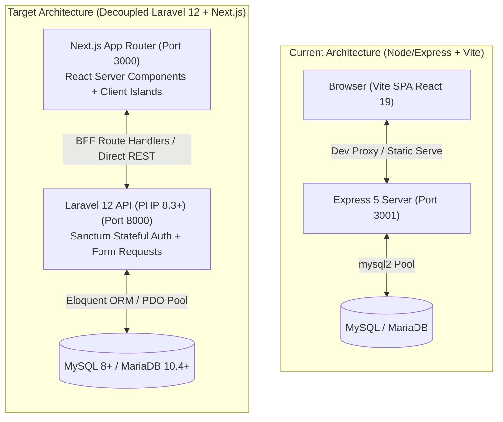
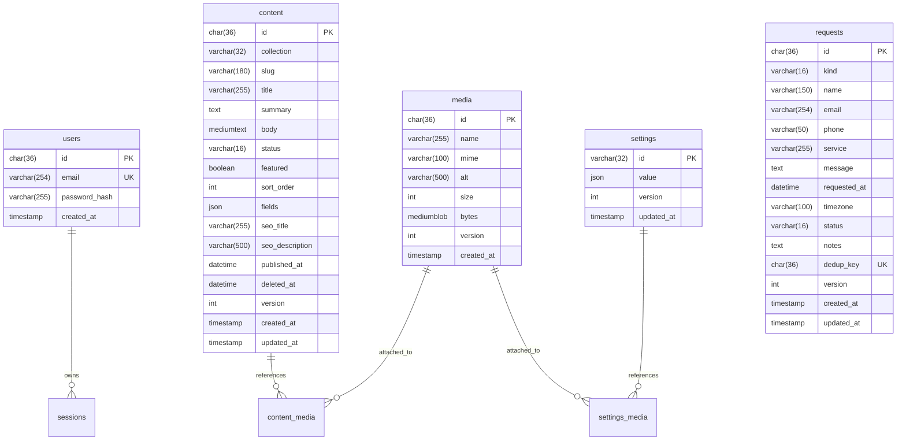
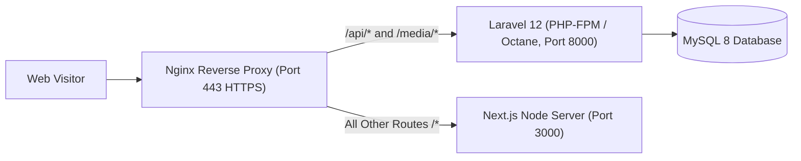
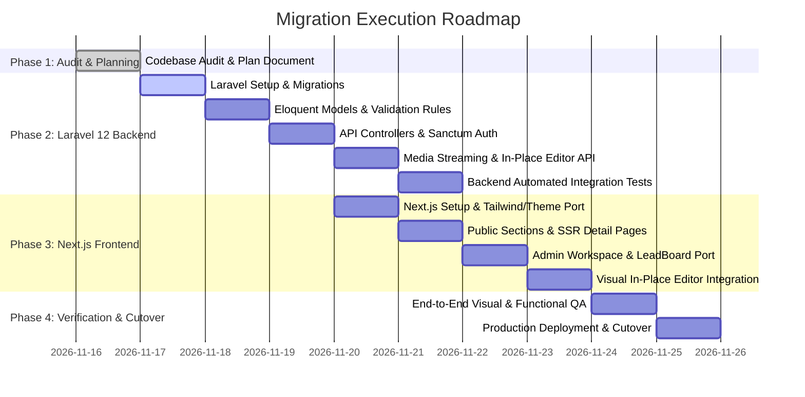

# Migration Plan: Tanvir Portfolio CMS
## From Node.js / Express 5 / Vite 6 to Laravel 12 / Next.js / MySQL

**Target Stack:**
- **Backend:** Laravel 12 (PHP 8.3+)
- **Frontend:** Next.js (App Router, React 19, TypeScript)
- **Database:** MySQL 8.0+ / MariaDB 10.4+
- **Styling & UI:** Tailwind CSS, Framer Motion, Lucide Icons

---

## 1. Executive Summary & Migration Objectives

The primary goal of this migration is to transition the **Md Tanvir Hossain Portfolio CMS** from an Express 5 + Vite Single Page Application (SPA) architecture into a modern, decoupled, enterprise-grade web application powered by **Laravel 12** on the backend and **Next.js (App Router)** on the frontend.

### Core Non-Negotiable Guarantees
1. **Zero Data Loss**: 100% preservation of all existing content, settings, users, media BLOBs, leads, and historical migrations.
2. **Zero Security Regression**: Full retention of origin verification, double-submit CSRF protection, rate limiting, bcrypt password compatibility, HTML sanitization, and dynamic Content Security Policy (CSP).
3. **100% Visual & Interaction Parity**: Exact preservation of the 3 design themes (*Editorial*, *Studio*, *Executive*), Framer Motion transitions, responsive layouts, and Lucide icons.
4. **Complete Feature Parity**: Retention of in-place visual live editing (`?edit=1`), drag-and-drop section ordering, the Kanban LeadBoard, Contact Inbox, and binary media asset streaming.
5. **SEO Enhancement**: Leveraging Next.js Server Components and dynamic SSR metadata to achieve superior search engine indexing over the legacy client-side SPA model.

---

## 2. Current vs. Target Architecture



### Architectural Comparison Matrix

| Aspect | Current Architecture | Target Architecture | Migration Strategy |
| :--- | :--- | :--- | :--- |
| **Backend Runtime** | Node.js 22+ (ES Modules) | PHP 8.3+ / 8.4 CLI & FPM | Laravel 12 standard framework structure |
| **HTTP Framework** | Express 5.3 (`server/app.mjs`) | Laravel 12 (`routes/api.php`) | Route groups, Form Requests, API Resources |
| **Database Access** | Raw SQL queries with `mysql2` | Laravel Eloquent ORM + Query Builder | Models with custom attribute casting & transactions |
| **Frontend Runtime** | Vite 6 Client SPA (`index.html`) | Next.js 15+ (App Router, Turbopack) | Hybrid: Server Components (SSR/SEO) + Client Components (Interactions) |
| **Routing** | Custom browser history popstate | Next.js App Router (`app/` directory) | Dynamic filesystem routes (`[collection]/[slug]`, `admin/`, etc.) |
| **Authentication** | `express-session` + `MysqlStore` | Laravel Sanctum (Stateful Cookie Sessions) | Session cookie `portfolio_session` matching existing user hashes |
| **Media Pipeline** | Express streaming from `MEDIUMBLOB` | Laravel Controller streaming from DB | Binary streaming response with `ETag` and immutable headers |
| **Visual Editor** | In-place DOM binding (`EditBinding.tsx`) | Next.js Client Editor Context + Server Sync | Iframe `/` preview with postMessage / optimistic draft state |

---

## 3. Existing Feature Inventory

Every capability in the current codebase has been mapped to its target implementation:

### 3.1 Public Website Features
- **Dynamic Homepage**: Multi-section layout with order determined by `settings.homepage.sectionOrder` and `sections`.
- **Homepage Sections**:
  - `hero`: Dual title, badge, bio, stats, CTA buttons, hero portrait.
  - `trust`: Client logos, proof metrics, trust counters.
  - `about`: High-level philosophy, core competencies.
  - `journey`: Deep story, milestones, link to full `/about` page.
  - `services`: Service cards, dynamic Lucide icon rendering, feature checklists, direct booking CTA.
  - `videos`: YouTube embed cards with duration badges and video IDs.
  - `projects`: Portfolio cards, technology pills, client details, live demo links.
  - `deals`: Discount cards with countdown timers, coupon copy buttons, affiliate links.
  - `gallery`: Visual masonry of events, workshops, and speaking engagements.
  - `resources`: Curated download cards with free vs. paid badges, WhatsApp integration.
  - `testimonials`: Client feedback cards, star ratings, avatar images, video reviews.
  - `booking`: Embedded interactive appointment/strategy call request form.
  - `closingCta`: Bold conversion banner with primary contact trigger.
  - `footer`: Dynamic sitemap links, social media icon row, copyright.
  - `floatingActions`: Sticky WhatsApp chat trigger and quick booking shortcuts.
- **Dedicated Sub-pages**:
  - `/about`: Detailed career narrative and philosophy.
  - `/services`: Comprehensive service catalog.
  - `/projects`: Complete portfolio archive with category filters.
  - `/deals`: Full deals and tool recommendation directory.
  - `/resources`: Full downloadable resource library.
  - `/blog`: Article listing and reading views.
  - `/[collection]/[slug]`: Server-rendered dynamic detail view for any published record.
- **Public Integrations**:
  - Facebook (Meta) Pixel tracking (`PageView`).
  - Google Tag Manager (GTM) container script.
  - TikTok Analytics Pixel.
  - Custom Header & Body HTML/CSS/JS snippet injection with dynamic CSP relaxation.

### 3.2 Visual In-Place Editor (`?edit=1`)
- **Direct Highlight & Edit**: Click-to-edit text fields and media pickers directly over the real page markup.
- **Draft Buffer**: Changes held in browser state with live preview; discard or publish all in one action.
- **Batch Atomic Save**: Up to 500 changes sent in a single `PATCH /api/admin/editor` transaction.
- **Optimistic Concurrency**: Row-level version matching prevents overwriting simultaneous edits.

### 3.3 Admin Workspace (`/admin`)
- **Dashboard**: Metric cards (content item counts by status, leads by status, 8 most recent leads).
- **Collection Management**: Full CRUD, pagination, search, filter (draft/published/deleted), and soft-delete/restore for 8 collections: `services`, `projects`, `blog`, `resources`, `videos`, `deals`, `testimonials`, `gallery`.
- **Media Library**:
  - Binary file uploads (PNG, JPEG, WebP, PDF up to 5 MB).
  - Search, alt text editing, filename renaming.
  - Binary file replacement with optimistic version checks.
  - Usage tracker inspecting both `content_media` and `settings_media`.
- **Lead Board (CRM)**:
  - Kanban board with 5 pipeline stages (`new`, `contacted`, `scheduled`, `completed`, `cancelled`).
  - Drag-and-drop status transitions with version-locking.
  - Detailed modal view: lead notes, timezone-aware timestamp, contact info.
- **Contact Inbox**: Dedicated chronological message manager for general inquiries.
- **Appearance & Theme Settings**:
  - Switcher between 3 core themes (*Editorial*, *Studio*, *Executive*).
  - Palette customizer (Primary, Green, Lime, Lavender, Background, Surface, Border, Text).
  - Dark/Light mode preference toggling.
  - Live desktop/mobile responsive preview iframe (`?preview=design`).
- **Section Order & Visibility**: Drag-and-drop homepage section order customizer (`SectionToggles.tsx`).
- **Site Extensions & Logos**: Form for GTM/Pixel IDs, custom code blocks, text vs. image brand logos.
- **Account & Security**: Password change with current-password verification and session revocation.

---

## 4. Database Migration Mapping

### 4.1 Table Schema & Laravel Migration Definitions

The existing MySQL 8 / MariaDB schema contains 9 tables. In Laravel 12, standard migrations will recreate these exact structures with matching types, character sets, and collation (`utf8mb4_unicode_ci`).



#### Mapping Table: Existing DDL vs. Laravel 12 Schema

| Existing Table | Existing Column Specifics | Laravel 12 Migration Blueprint |
| :--- | :--- | :--- |
| **`users`** | `id CHAR(36) PRIMARY KEY`<br>`email VARCHAR(254) UNIQUE`<br>`password_hash VARCHAR(255)` | `$table->uuid('id')->primary();`<br>`$table->string('email', 254)->unique();`<br>`$table->string('password', 255);`<br>`$table->timestamp('created_at')->useCurrent();` |
| **`sessions`** | `sid VARCHAR(128) PRIMARY KEY`<br>`data MEDIUMTEXT`<br>`expires_at BIGINT` | Use Laravel 12 native database session driver or custom schema matching `portfolio_session`. |
| **`media`** | `id CHAR(36) PRIMARY KEY`<br>`name VARCHAR(255)`<br>`mime VARCHAR(100)`<br>`alt VARCHAR(500)`<br>`size INT`<br>`bytes MEDIUMBLOB`<br>`version INT DEFAULT 1` | `$table->uuid('id')->primary();`<br>`$table->string('name', 255);`<br>`$table->string('mime', 100);`<br>`$table->string('alt', 500)->default('');`<br>`$table->unsignedInteger('size');`<br>`$table->binary('bytes', MediumBlob);`<br>`$table->unsignedInteger('version')->default(1);` |
| **`content`** | `id CHAR(36) PRIMARY KEY`<br>`collection VARCHAR(32)`<br>`slug VARCHAR(180)`<br>`fields JSON`<br>`status VARCHAR(16) DEFAULT 'draft'`<br>`version INT DEFAULT 1` | `$table->uuid('id')->primary();`<br>`$table->string('collection', 32);`<br>`$table->string('slug', 180);`<br>`$table->json('fields');`<br>`$table->unique(['collection', 'slug']);`<br>`$table->index(['collection', 'status', 'deleted_at', 'sort_order']);` |
| **`content_media`** | `content_id CHAR(36)`<br>`media_id CHAR(36)`<br>`PRIMARY KEY (content_id, media_id)` | `$table->uuid('content_id');`<br>`$table->uuid('media_id');`<br>`$table->primary(['content_id', 'media_id']);`<br>`$table->foreign('content_id')->references('id')->on('content')->cascadeOnDelete();`<br>`$table->foreign('media_id')->references('id')->on('media')->restrictOnDelete();` |
| **`settings`** | `id VARCHAR(32) PRIMARY KEY`<br>`value JSON`<br>`version INT DEFAULT 1` | `$table->string('id', 32)->primary();`<br>`$table->json('value');`<br>`$table->unsignedInteger('version')->default(1);`<br>`$table->timestamp('updated_at')->useCurrent()->useCurrentOnUpdate();` |
| **`settings_media`**| `settings_id VARCHAR(32)`<br>`media_id CHAR(36)`<br>`PRIMARY KEY (settings_id, media_id)` | `$table->string('settings_id', 32);`<br>`$table->uuid('media_id');`<br>`$table->primary(['settings_id', 'media_id']);`<br>`$table->foreign('settings_id')->references('id')->on('settings')->cascadeOnDelete();`<br>`$table->foreign('media_id')->references('id')->on('media')->restrictOnDelete();` |
| **`requests`** | `id CHAR(36) PRIMARY KEY`<br>`dedup_key CHAR(36) UNIQUE`<br>`status VARCHAR(16) DEFAULT 'new'`<br>`version INT DEFAULT 1` | `$table->uuid('id')->primary();`<br>`$table->string('kind', 16);`<br>`$table->uuid('dedup_key')->unique();`<br>`$table->unsignedInteger('version')->default(1);`<br>`$table->index(['kind', 'status', 'created_at']);` |

---

## 5. Laravel 12 Model & Controller Mapping

### 5.1 Eloquent Models
1. **`User` (`app/Models/User.php`)**:
   - Uses `HasUuids` trait.
   - Disables auto-incrementing; sets `$keyType = 'string'`.
   - Hidden: `password` (mapped to `password_hash`).
   - Custom authentication provider mapping `getAuthPassword()` to `password_hash`.
2. **`Content` (`app/Models/Content.php`)**:
   - Uses `HasUuids` trait.
   - Casts: `'fields' => 'array'`, `'featured' => 'boolean'`, `'sort_order' => 'integer'`, `'version' => 'integer'`, `'published_at' => 'datetime'`, `'deleted_at' => 'datetime'`.
   - Scope: `scopePublished($query)` filtering `status = 'published'`, `deleted_at IS NULL`, and `published_at <= now()`.
   - Relationships: `belongsToMany(Media::class, 'content_media', 'content_id', 'media_id')`.
3. **`Media` (`app/Models/Media.php`)**:
   - Uses `HasUuids` trait.
   - Casts: `'size' => 'integer'`, `'version' => 'integer'`.
   - Relationships:
     - `belongsToMany(Content::class, 'content_media', 'media_id', 'content_id')`
     - `belongsToMany(Setting::class, 'settings_media', 'media_id', 'settings_id')`
4. **`Setting` (`app/Models/Setting.php`)**:
   - Primary key `$primaryKey = 'id'`, `$keyType = 'string'`, `$incrementing = false`.
   - Casts: `'value' => 'array'`, `'version' => 'integer'`.
   - Relationships: `belongsToMany(Media::class, 'settings_media', 'settings_id', 'media_id')`.
5. **`LeadRequest` (`app/Models/LeadRequest.php`)**:
   - Table: `requests`.
   - Uses `HasUuids` trait.
   - Casts: `'requested_at' => 'datetime'`, `'version' => 'integer'`.

### 5.2 Laravel Controllers & Services

```
app/
├── Http/
│   ├── Controllers/
│   │   ├── Api/
│   │   │   ├── AuthController.php          # Session check, login, logout, password change
│   │   │   ├── PublicController.php        # Site bootstrap (/site), appearance, detail
│   │   │   ├── RequestController.php       # Lead & contact submission (rate-limited)
│   │   │   ├── MediaController.php         # Public & admin media streaming
│   │   │   ├── Admin/
│   │   │   │   ├── DashboardController.php # Aggregate dashboard metrics
│   │   │   │   ├── ContentController.php   # Collection CRUD & soft-delete
│   │   │   │   ├── SettingController.php   # Module settings update & validation
│   │   │   │   ├── LeadController.php      # CRM lead management & Kanban status updates
│   │   │   │   ├── MediaAdminController.php# Upload, update, delete, usage
│   │   │   │   └── EditorController.php    # Batch in-place visual editing PATCH
│   ├── Requests/                           # Form Requests replacing Zod schemas
│   │   ├── LoginRequest.php
│   │   ├── ContentStoreRequest.php
│   │   ├── SettingUpdateRequest.php
│   │   ├── LeadSubmissionRequest.php
│   │   └── EditorBatchRequest.php
│   └── Middleware/
│       ├── VerifyAppOrigin.php             # Strict Origin === APP_ORIGIN validation
│       ├── DynamicContentSecurityPolicy.php# Evaluates settings for Pixel/GTM CSP
│       └── EnsureValidCsrfToken.php        # Double-submit cookie verification
└── Services/
    ├── ContentSanitizer.php                # HTML cleaning (HTMLPurifier or Mews/Purifier)
    ├── MediaReferenceSync.php              # Regex & JSON walker syncing content_media
    └── SettingsDefinitionService.php       # Loads settings-definition.json allowlist
```

---

## 6. Complete API Endpoint Mapping

All API endpoints will preserve their exact HTTP methods, URI signatures, and JSON response bodies so the frontend requires zero contract alterations.

| Method | Endpoint | Existing Express Handler | Laravel 12 Controller Action | Auth / Middleware |
| :--- | :--- | :--- | :--- | :--- |
| `GET` | `/api/health` | `app.get("/api/health")` | `PublicController@health` | Public |
| `GET` | `/api/auth/session` | `app.get("/api/auth/session")` | `AuthController@session` | Public (generates CSRF) |
| `POST` | `/api/auth/login` | `app.post("/api/auth/login")` | `AuthController@login` | RateLimit (10/15m), CSRF, Origin |
| `POST` | `/api/auth/logout` | `app.post("/api/auth/logout")` | `AuthController@logout` | `auth:sanctum`, CSRF |
| `POST` | `/api/auth/password` | `app.post("/api/auth/password")` | `AuthController@changePassword`| `auth:sanctum`, CSRF |
| `GET` | `/api/public/appearance`| `app.get("/api/public/appearance")` | `PublicController@appearance` | Public |
| `GET` | `/api/public/site` | `app.get("/api/public/site")` | `PublicController@site` | Public (no-store) |
| `GET` | `/api/public/{col}/{slug}`| `app.get("/api/public/:col/:slug")`| `PublicController@detail` | Public (no-store) |
| `POST` | `/api/requests` | `app.post("/api/requests")` | `RequestController@store` | RateLimit (10/1h), Honeypot |
| `GET` | `/media/{id}` | `app.get("/media/:id")` | `MediaController@show` | Public (protected-check) |
| `GET` | `/api/admin/dashboard` | `app.get("/api/admin/dashboard")` | `DashboardController@index` | `auth:sanctum`, CSRF |
| `GET` | `/api/admin/content/{col}`| `app.get("/api/admin/content/:col")`| `ContentController@index` | `auth:sanctum`, CSRF |
| `POST` | `/api/admin/content/{col}`| `app.post("/api/admin/content/:col")`| `ContentController@store`| `auth:sanctum`, CSRF |
| `PUT` | `/api/admin/content/{col}/{id}`| `app.put("/api/admin/content/:col/:id")`| `ContentController@update`| `auth:sanctum`, CSRF |
| `POST` | `/api/admin/content/{col}/{id}/{action}`| `app.post("/.../:action")` | `ContentController@action` | `auth:sanctum`, CSRF |
| `GET` | `/api/admin/settings` | `app.get("/api/admin/settings")` | `SettingController@index` | `auth:sanctum`, CSRF |
| `PUT` | `/api/admin/settings/{id}`| `app.put("/api/admin/settings/:id")`| `SettingController@update` | `auth:sanctum`, CSRF |
| `GET` | `/api/admin/requests` | `app.get("/api/admin/requests")` | `LeadController@index` | `auth:sanctum`, CSRF |
| `GET` | `/api/admin/requests/{id}`| `app.get("/api/admin/requests/:id")`| `LeadController@show` | `auth:sanctum`, CSRF |
| `PUT`/`PATCH`| `/api/admin/requests/{id}`| `app.patch("/api/admin/requests/:id")`| `LeadController@update`| `auth:sanctum`, CSRF |
| `GET` | `/api/admin/media` | `app.get("/api/admin/media")` | `MediaAdminController@index`| `auth:sanctum`, CSRF |
| `POST` | `/api/admin/media` | `app.post("/api/admin/media")` | `MediaAdminController@store`| `auth:sanctum`, CSRF, 5MB limit |
| `PUT` | `/api/admin/media/{id}` | `app.put("/api/admin/media/:id")` | `MediaAdminController@update`| `auth:sanctum`, CSRF |
| `PUT` | `/api/admin/media/{id}/file`| `app.put("/api/admin/media/:id/file")`| `MediaAdminController@replace`| `auth:sanctum`, CSRF |
| `GET` | `/api/admin/media/{id}/usage`| `app.get("/api/admin/media/:id/usage")`| `MediaAdminController@usage`| `auth:sanctum`, CSRF |
| `DELETE`| `/api/admin/media/{id}` | `app.delete("/api/admin/media/:id")` | `MediaAdminController@destroy`| `auth:sanctum`, CSRF |
| `GET` | `/api/admin/editor` | `app.get("/api/admin/editor")` | `EditorController@snapshot` | `auth:sanctum`, CSRF |
| `PATCH`| `/api/admin/editor` | `app.patch("/api/admin/editor")` | `EditorController@batchSave`| `auth:sanctum`, CSRF (transactional)|

---

## 7. Next.js Frontend Migration Strategy

### 7.1 Architecture & Directory Layout (App Router)

The current Vite single-bundle SPA will transition to a **Next.js 15 App Router** architecture with React 19:

```
next-frontend/
├── app/
│   ├── layout.tsx                 # Root layout with dynamic theme CSS variables & fonts
│   ├── page.tsx                   # SSR Homepage rendering dynamic ordered sections
│   ├── about/page.tsx             # Server-rendered /about view
│   ├── services/page.tsx          # Server-rendered /services listing
│   ├── projects/page.tsx          # Server-rendered /projects listing
│   ├── deals/page.tsx             # Server-rendered /deals listing
│   ├── resources/page.tsx         # Server-rendered /resources listing
│   ├── blog/page.tsx              # Server-rendered /blog listing
│   ├── [collection]/[slug]/       # Dynamic Detail Route (Services, Projects, Blog, etc.)
│   │   ├── page.tsx               # Server-rendered with generateMetadata()
│   ├── admin/                     # Admin Workspace
│   │   ├── layout.tsx             # Admin header, navigation, and auth guard
│   │   ├── page.tsx               # Admin Dashboard / Module Switcher
│   ├── robots.ts                  # Dynamic robots.txt generation
│   ├── sitemap.ts                 # Dynamic sitemap.xml fetching published records
│   └── api/proxy/[...path]/       # BFF route handlers (if proxying is required)
├── components/                    # Preserved UI Components
│   ├── ui/                        # Button, Dialog, Dropdown, Lucide wrappers
│   ├── public/                    # Hero, Navbar, Footer, ServicesSection, etc.
│   ├── admin/                     # LeadBoard, ContactInbox, AdminMediaLibrary, ThemePicker
│   └── editor/                    # VisualEditor, EditBinding
├── lib/
│   ├── api.ts                     # Type-safe client for Laravel API
│   ├── theme.ts                   # Palette applicator & CSS variable generator
│   └── integrations.ts            # Client pixel initialization
└── styles/
    ├── globals.css                # Tailwind directives & CSS variable definitions
    ├── design-themes.css          # Editorial, Studio, Executive typography & styles
    └── public.css                 # Public layout styles
```

### 7.2 Server Components (RSC) vs. Client Components
- **Server Components (Default)**:
  - Homepage (`app/page.tsx`): Pre-fetches `/api/public/site` on the server. Renders initial HTML with full SEO content, zero client layout shifts, and instantaneous First Contentful Paint.
  - Detail Pages (`app/[collection]/[slug]/page.tsx`): Pre-fetches the specific record, generating full `<article>` markup and OpenGraph metadata directly in the server response.
- **Client Components (`"use client"`)**:
  - `Navbar.tsx`: Mobile menu toggles, active anchor highlighting.
  - `RequestForm.tsx` & `BookingSection.tsx`: Form validation, honeypot checking, API submission.
  - `LeadBoard.tsx`: Drag-and-drop Kanban pipeline.
  - `VisualEditor.tsx`: In-place live DOM editor.
  - `ThemePicker.tsx`: Live theme preview frames.

### 7.3 Preserving Framer Motion & Reduced Motion
In Next.js App Router, Framer Motion requires the `"use client"` directive on wrapper components. A client-side `<MotionProvider>` will wrap pages with `<MotionConfig reducedMotion="...">` respecting the owner's `websiteMotion` setting and the visitor's `prefers-reduced-motion` browser preference.

---

## 8. Authentication & Session Migration

### 8.1 Password Compatibility
- The existing system uses standard **bcrypt** (`$2b$12$...` salt rounds).
- PHP's native `password_verify()` and Laravel's `Hash::check()` natively support `$2a$`, `$2b$`, and `$2y$` bcrypt hashes.
- Existing user credentials in the `users` table will work immediately without password resets or re-hashing.

### 8.2 Laravel Sanctum Stateful Session Authentication
- Next.js and Laravel will share the same top-level domain (or use a reverse proxy such as Nginx in production, maintaining a unified origin).
- Laravel Sanctum provides stateful cookie-based authentication via `portfolio_session`.
- The CSRF token workflow:
  1. Next.js calls `GET /sanctum/csrf-cookie` or `/api/auth/session`.
  2. Laravel returns the CSRF cookie and session status.
  3. All mutating calls (`POST`, `PUT`, `PATCH`, `DELETE`) pass the token via `X-CSRF-Token` or `X-XSRF-Token`.

---

## 9. Security Migration & Hardening

| Security Mechanism | Current Express Implementation | Target Laravel 12 Implementation |
| :--- | :--- | :--- |
| **Origin Verification** | Compares `req.get("origin") === origin` on write routes | Custom middleware `VerifyAppOrigin` rejecting mismatched origins with `403 Forbidden` |
| **Double-Submit CSRF** | Timing-safe check of `x-csrf-token` header vs. session | Laravel Sanctum middleware `ValidateCsrfToken` with timing-safe string comparison |
| **Rate Limiting** | `express-rate-limit` (10/15m on login; 10/1h on requests) | Laravel `RateLimiter::for('login')` and `RateLimiter::for('leads')` using Redis or DB cache |
| **HTML Sanitization** | `sanitize-html` allowing small whitelist of tags | `Mews/Purifier` (HTMLPurifier) configured with the identical whitelist |
| **File Verification** | `fileTypeFromBuffer` verifying magic bytes | Laravel's `$request->file('file')->getMimeType()` checking libmagic / fileinfo |
| **Input Validation** | Zod schemas with regex rules | Laravel `FormRequest` classes with custom Rule objects |
| **Honeypot Protection**| Empty `website` field in `requestSchema` | Laravel FormRequest asserting `website` field is absent or empty string |

---

## 10. Media Storage Migration Strategy

### The Binary BLOB Trade-Off
The current architecture stores file bytes directly in the `media.bytes` column (`MEDIUMBLOB`). This was an intentional design decision to allow single-file database backups (`mysqldump --hex-blob`) without filesystem synchronization drift.

### Migration Strategy: Dual-Compatible Media Engine
1. **Preserve Current DB BLOB Storage (Recommended for Parity)**:
   - Laravel 12 will read `media.bytes` and stream it directly using `response()->stream()`:
   ```php
   return response($media->bytes, 200, [
       'Content-Type' => $media->mime,
       'Content-Length' => $media->size,
       'Cache-Control' => 'private, no-store',
       'Content-Disposition' => ($media->mime === 'application/pdf' ? 'attachment' : 'inline') . '; filename="' . $media->id . '"',
   ]);
   ```
2. **Optional Phase 2 Transition (Filesystem / S3 Storage)**:
   - If database performance optimization is desired later, a migration script can extract the BLOBs to `storage/app/public/media/{id}` and update the `media` table to store a relative disk path instead.
   - For Phase 1, the BLOB model will be retained to guarantee zero migration friction.

---

## 11. SEO & Metadata Preservation

In the legacy SPA, an Express middleware scraped the database and regex-replaced `<title>`, `<meta>`, and `<div id="root">` before sending `index.html`.

In Next.js, this is handled natively and cleanly via **Dynamic Metadata**:
- In `app/[collection]/[slug]/page.tsx`:
```typescript
export async function generateMetadata({ params }): Promise<Metadata> {
  const record = await fetchPublicDetail(params.collection, params.slug);
  return {
    title: record.seo_title || record.title,
    description: record.seo_description || record.summary,
    alternates: { canonical: `${siteUrl}/${params.collection}/${params.slug}` },
    openGraph: {
      title: record.seo_title || record.title,
      description: record.seo_description || record.summary,
      url: `${siteUrl}/${params.collection}/${params.slug}`,
      type: 'article',
      images: record.fields.image ? [record.fields.image] : [],
    },
  };
}
```
- `robots.ts` and `sitemap.ts` will dynamically query the Laravel API for all published slugs, ensuring zero broken links or indexing penalties.

---

## 12. Deployment Architecture & Infrastructure

### Recommended Production Setup (Single Origin via Reverse Proxy)

To eliminate cross-origin complexity, CORS bugs, and multi-domain cookie issues, the production environment will use Nginx (or Hostinger / Cloudflare reverse proxy):



### Environment Variables Mapping

| Environment Variable | Express / Vite | Laravel 12 (`.env`) | Next.js (`.env.local`) |
| :--- | :--- | :--- | :--- |
| **Origin URL** | `APP_ORIGIN` | `SANCTUM_STATEFUL_DOMAINS`, `APP_URL` | `NEXT_PUBLIC_SITE_URL` |
| **API Base URL** | Vite Proxy | N/A | `NEXT_PUBLIC_API_URL` |
| **Database Host** | `DB_HOST` | `DB_HOST` | N/A |
| **Database Port** | `DB_PORT` | `DB_PORT` | N/A |
| **Database Name** | `DB_NAME` | `DB_DATABASE` | N/A |
| **Database User** | `DB_USER` | `DB_USERNAME` | N/A |
| **Database Pass** | `DB_PASSWORD` | `DB_PASSWORD` | N/A |
| **Session Secret** | `SESSION_SECRET` | `APP_KEY` (via `php artisan key:generate`) | N/A |

---

## 13. Potential Breaking Changes & Mitigation Strategies

| Risk / Edge Case | Potential Impact | Mitigation Strategy |
| :--- | :--- | :--- |
| **Bcrypt Salt Prefix Difference** | PHP usually outputs `$2y$`, Node outputs `$2b$` | PHP's `password_verify()` natively handles both `$2b$` and `$2y$` without issue. Verified. |
| **JSON Column Encoding** | Escaping differences in MySQL JSON fields | Use `json_encode($fields, JSON_UNESCAPED_UNICODE | JSON_UNESCAPED_SLASHES)` to match Node's output. |
| **Next.js Hydration Mismatches** | Theme CSS variables applied after mount | Server injects CSS variables inline in `app/layout.tsx` before DOM paint. |
| **Visual Editor Iframe Communication** | Next.js security headers blocking `/?preview=design` | Add `frame-ancestors 'self'` to CSP in Next.js middleware and Laravel headers. |
| **MySQL Max Packet Size** | 5 MB upload exceeding `max_allowed_packet` | Verify `max_allowed_packet=16M` in `my.ini` / `my.cnf`. |

---

## 14. Phased Implementation Roadmap



- **Phase 1 (Current)**: Forensic audit, schema extraction, and architectural planning (**COMPLETED**).
- **Phase 2**: Scaffold Laravel 12 backend in a parallel directory; implement models, migrations, controllers, Sanctum auth, and unit tests.
- **Phase 3**: Scaffold Next.js App Router frontend in a parallel directory; port Tailwind styles, components, Framer Motion animations, admin panels, and visual editor.
- **Phase 4**: Comprehensive regression testing against real MySQL data, security audits, and cutover.
