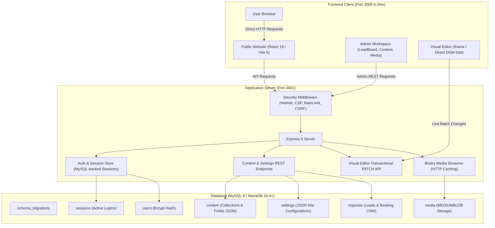
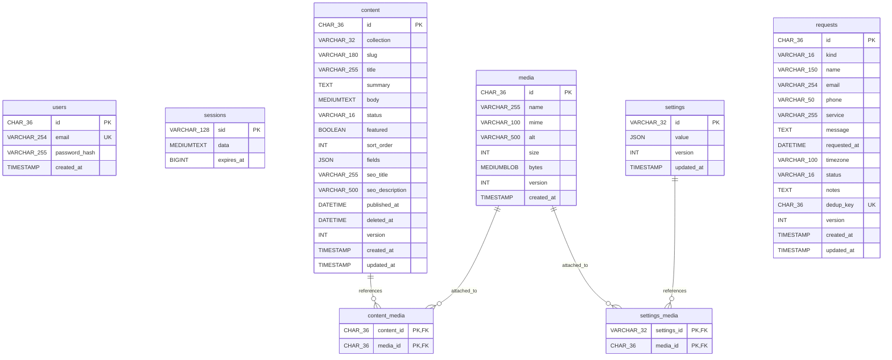
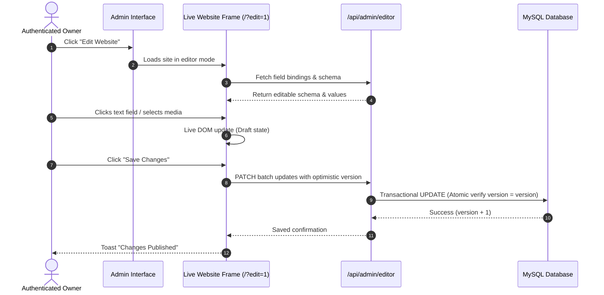

# Tanvir Portfolio CMS: Complete Architecture, System Design & Development Blueprint

A comprehensive, end-to-end technical guide to the **Md Tanvir Hossain Portfolio CMS** — covering its architectural philosophy, tech stack, database schema, migration history, security enforcement, in-place visual editing engine, and operational runbook.

---

## 1. Executive Summary & Purpose

The **Md Tanvir Hossain Portfolio CMS** is a bespoke, self-hosted web application built specifically for an eCommerce Architect & Automation Specialist. Originally conceived as a static front-end showcase, it was systematically transformed into an integrated Content Management System (CMS) and lead acquisition platform.

### Core Design Philosophy
- **Zero Third-Party Backend Lock-in**: Eliminates reliance on external BaaS (Backend-as-a-Service) providers such as Firebase, Supabase, or external headless CMS platforms.
- **Unified Single-Origin Deployment**: Both the React client and the Express API operate under a single origin in production, removing complex cross-origin credential issues.
- **Single-Backup Portability**: Binary uploaded media (images, PDFs) reside inside MySQL database tables (`MEDIUMBLOB`). A standard `mysqldump` captures the entire state (users, sessions, site settings, content, and uploaded assets), eliminating filesystem synchronization drift.
- **No Cold-Start Overhead**: Native Node.js Express process ensures instantaneous sub-millisecond response times compared to serverless cold starts.
- **In-Place Visual Editing**: Provides an authenticated, live-preview visual editing layer directly over the production templates with optimistic concurrent versioning.

---

## 2. System Architecture & Tech Stack



### Technology Breakdown

| Domain | Technology | Version | Purpose |
| :--- | :--- | :--- | :--- |
| **Frontend Framework** | React | `^19.2.3` | Modern component rendering, hooks, fast hydration |
| **Build & Bundling** | Vite | `^6.2.0` | Ultra-fast HMR, optimized production asset bundling |
| **Language** | TypeScript | `~5.8.2` | Strict compile-time typing for frontend contracts |
| **Styling** | Tailwind CSS + PostCSS | `^3.4.19` | Utility-first CSS with dynamic theme variables |
| **Motion & Animation** | Framer Motion | `^12.43.0` | Fluid page transitions, modal animations, tabs |
| **Icons** | Lucide React | `0.474.0` | Crisp SVG iconography across admin and public views |
| **Backend Framework** | Express | `^5.3.0` | Robust routing, error handling, same-origin delivery |
| **Database Engine** | MySQL / MariaDB | `8.0+ / 10.4+` | Relational storage, JSON fields, ACID transactions |
| **Database Driver** | MySQL2 | `^3.24.6` | Connection pooling, prepared statements, async/await |
| **Schema Validation** | Zod | `^4.6.7` | Strict runtime type-checking for API payloads |
| **Password Security** | BcryptJS | `^3.0.3` | Cost factor 12 adaptive password hashing |
| **Security Headers** | Helmet | `^8.3.0` | HTTP response headers & dynamic Content Security Policy |
| **Rate Limiting** | Express Rate Limit | `^8.7.3` | Brute force defense on auth and lead forms |
| **File Processing** | Multer + File-Type | `^2.5.0` / `^22.3.0` | In-memory upload handling and magic byte MIME verification |
| **HTML Sanitization** | Sanitize-HTML | `^2.18.1` | XSS prevention for user-authored rich text |

---

## 3. Database Architecture & Migrations

The database is built on an append-only migration pipeline managed by `scripts/migrate.mjs`.

### Migration Engine Mechanism
1. Obtains a database-level lock using MySQL `GET_LOCK('portfolio_migrations', 10)`.
2. Creates the tracking table `schema_migrations` if not already present.
3. Reads all `.sql` files in `server/migrations/` sorted alphanumerically.
4. Executes pending migrations sequentially, split by `;`.
5. Records applied migrations with timestamp tracking.
6. Releases the lock upon completion or error via `RELEASE_LOCK`.

### Complete Table Schema Reference



### Chronological Migration Evolution

1. **`001_initial.sql`**: Baseline tables (`users`, `sessions`, `media`, `content`, `content_media`, `settings`, `settings_media`, `requests`).
2. **`002_homepage_images.sql`**: Splits singular portrait references into dedicated `heroPortrait` and `journeyPortrait`.
3. **`003_appearance.sql`**: Introduces color palette storage (`websitePrimaryColor`, `adminPrimaryColor`, `websiteTheme`).
4. **`004_gallery_visibility.sql`**: Adds visibility toggles for the homepage gallery, closing CTA, blog, navigation, and floating actions.
5. **`005_website_palette.sql`**: Extends theme variables with green, lime, lavender, background, surface, text, and border tokens.
6. **`006_home_menu.sql`**: Adds editable primary navigation labels and targets.
7. **`007_loading_line.sql`**: Adds configuration for the top progress bar accent and duration.
8. **`008_design_themes.sql`**: Establishes layout options (`Editorial`, `Studio`, `Executive`) with font scale and card radius controls.
9. **`009_editor_labels.sql`**: Injects localized/customizable presentation copy for section titles and badges.
10. **`010_editor_form_labels.sql`**: Adds in-place editable labels for booking inputs, buttons, and status notices.
11. **`011_section_order.sql`**: Adds `homepage.sectionOrder` supporting persistent drag-and-drop homepage reordering.
12. **`012_media_lead_versions.sql`**: Adds optimistic concurrency `version` integer columns to `media` and `requests`.
13. **`013_integrations_logos.sql`**: Stores configurations for Facebook Pixel, Google Tag Manager, TikTok Pixel, custom HTML/CSS/JS, and header/footer brand logos.

---

## 4. Backend Implementation & Security Model

The backend runs as an Express 5 server in `server/app.mjs`.

### 1. Authentication & Session Pipeline
- **No Public Registration**: Admin accounts cannot be created via HTTP. Bootstrapping requires the CLI tool `scripts/bootstrap.mjs`.
- **Session Management**: Implemented via custom `MysqlStore` (`server/session-store.mjs`). Active sessions survive server restarts and expire automatically via database cleanup routines.
- **Double Submit CSRF Guard**: Authenticated mutating requests (`POST`, `PATCH`, `DELETE`) require a valid `X-CSRF-Token` header matching the signed cookie token.
- **Bcrypt Hash Verification**: Passwords are saved with 12 salt rounds; verification utilizes timing-safe comparison.

### 2. Defensive Rate Limiting & Sanitation
- **Authentication Throttling**: Strict IP-based limit of 5 failed attempts per 15-minute window on `/api/auth/login`.
- **Public Lead Form Limiting**: Maximum 10 submissions per hour per IP on `/api/public/requests`.
- **Content Sanitization**: Rich HTML inputs are stripped of arbitrary `<script>`, `<iframe>`, inline event listeners, and dangerous schemes using `sanitize-html`.

### 3. Binary Media Storage & Streaming
Files uploaded via `/api/admin/media` undergo strict validation:
1. File size is checked against the 5 MB limit.
2. Magic numbers are inspected via `fileTypeFromBuffer` to verify real MIME types (`image/png`, `image/jpeg`, `image/webp`, `application/pdf`). File extensions are discarded.
3. Bytes are saved into the `media.bytes` `MEDIUMBLOB` column.
4. When requested at `/media/:id`, the server serves the binary data with immutable `ETag` and `Cache-Control: public, max-age=31536000, immutable` headers.
5. If an image is updated, an optimistic version bump invalidates browser cache smoothly.

### 4. Dynamic Content Security Policy (CSP)
In `server/public-extensions.mjs`, CSP headers are dynamically computed based on active integrations:
- If Facebook Pixel is enabled: `connect.facebook.net` and `facebook.com` are allowed.
- If Google Tag Manager is enabled: `googletagmanager.com` is permitted.
- If TikTok Pixel is enabled: `analytics.tiktok.com` is allowed.
- Public pages allow iframe previewing from same-origin; admin pages enforce strict sandbox isolation.

---

## 5. Visual Editing Engine & Design Themes

The project includes an in-place visual website builder operating directly on the front-end.



### 3 Visual Themes
Managed via `design-themes.ts` and `design-themes.css`:
1. **Editorial**: High-contrast typography, refined serif headings, clean editorial borders, structured column grids.
2. **Studio**: Modern brutalist/creative aesthetic, vibrant accents, dark neon cards, subtle glassmorphic surfaces.
3. **Executive**: Sleek corporate look, polished slate surfaces, geometric cards, subdued enterprise accents.

---

## 6. How It Was Made: Step-by-Step Construction

### Phase 1: Codebase Audit & Extraction
- Conducted a forensic audit of the legacy static prototype.
- Separated hard-coded copy from code logic into `seed/original-content.tsx`.
- Identified security requirements: zero plain-text passwords, SQL injection protection via parameterized queries, CSRF mitigations.

### Phase 2: Schema Architecture & Migration Framework
- Designed normalized relational schema with JSON field support for variable collections.
- Implemented `scripts/migrate.mjs` with MySQL advisory locks for atomic deployments.
- Created `001_initial.sql` to establish foundational tables.

### Phase 3: Security & Authentication Hardening
- Created `server/session-store.mjs` to keep sessions persistent in MySQL.
- Built `scripts/bootstrap.mjs` for private interactive CLI admin account creation.
- Enforced strict CSRF double-cookie validation and IP rate limiting.

### Phase 4: Dynamic Theme & Layout Engine
- Abstracted hard-coded hex colors into CSS custom variables (`public.css`, `design-themes.css`).
- Built migrations `003_appearance.sql` through `008_design_themes.sql` to persist appearance choices.
- Created `ThemePicker.tsx` with live responsive desktop and mobile preview frames.

### Phase 5: In-Place Visual Editor Development
- Developed `EditBinding.tsx` and `VisualEditor.tsx`.
- Created transactional `/api/admin/editor` batch PATCH endpoint with rollback capabilities.
- Added drag-and-drop section reordering (`011_section_order.sql`).

### Phase 6: Leads CRM & Communications Module
- Developed `LeadBoard.tsx` (Kanban-style drag-and-drop pipeline for consultation requests).
- Developed `ContactInbox.tsx` (threaded view for contact form inquiries).
- Enforced version counters (`012_media_lead_versions.sql`) to avoid race conditions when updating lead statuses.

### Phase 7: Analytics, Tracking & Custom Scripts
- Created `SiteExtensions.tsx` for admin toggling of GTM, Meta Pixel, and TikTok tracking.
- Implemented `public-extensions.mjs` to dynamically alter CSP rules when tracking tools are activated.

---

## 7. Local Development & Production Runbook

### Local Environment Setup (Windows / XAMPP)

1. **Start MariaDB / MySQL**:
   ```powershell
   Start-Process -FilePath "C:\xampp\mysql\bin\mysqld.exe" -ArgumentList "--defaults-file=C:\xampp\mysql\bin\my.ini --standalone" -WindowStyle Hidden
   ```
2. **Verify Database Configuration** in `.env`:
   ```env
   NODE_ENV=development
   HOST=127.0.0.1
   PORT=3001
   APP_ORIGIN=http://localhost:3000
   DB_HOST=127.0.0.1
   DB_PORT=3306
   DB_USER=root
   DB_PASSWORD=
   DB_NAME=tanvir_portfolio_local
   SESSION_SECRET=<random-64-character-hex>
   TRUST_PROXY=0
   ```
3. **Run Schema Migrations**:
   ```powershell
   npm run migrate
   ```
4. **Seed Content (First Run Only)**:
   ```powershell
   npm run seed
   ```
5. **Start Dev Servers**:
   ```powershell
   # Terminal 1: Backend API
   npm run dev:server

   # Terminal 2: Frontend Vite
   npm run dev
   ```

### Production Deployment (Hostinger Node.js Web App)

1. **Hostinger Environment Configuration**:
   - Runtime: Node.js 22.x
   - Application Root: `/`
   - Startup File: `server/index.mjs`
   - Build Command: `npm ci --include=dev && npm run build`
2. **Environment Variables**:
   - `NODE_ENV=production`
   - `APP_ORIGIN=https://tanvirhossain.online`
   - `DB_HOST=127.0.0.1`
   - `DB_PORT=3306`
   - `DB_USER=<hostinger_db_user>`
   - `DB_PASSWORD=<strong_db_password>`
   - `DB_NAME=<hostinger_db_name>`
   - `SESSION_SECRET=<random-64-char-token>`
   - `TRUST_PROXY=1`
3. **Database Backup Procedure**:
   ```bash
   mysqldump --single-transaction --hex-blob --no-tablespaces -h 127.0.0.1 -u USER -p DATABASE > backup.sql
   ```
   > [!IMPORTANT]
   > The `--hex-blob` flag is mandatory to ensure binary image and PDF bytes in the `media` table are exported without character encoding corruption.

---

## 8. Summary of Completed System Architecture

The Tanvir Portfolio CMS provides a robust, self-contained architecture combining high-speed public performance with enterprise-grade admin management:

- **Frontend**: Responsive React 19 SPA with 3 selectable layout themes, SEO meta tags, and inline visual editing.
- **Backend**: Express 5 service with native session store, dynamic CSP, binary media streaming, and strict CSRF/rate-limit defense.
- **Storage**: ACID-compliant MySQL/MariaDB database with 13 idempotent migrations and binary asset persistence.
- **CRM**: Integrated booking and contact management with interactive Kanban pipeline boards.
