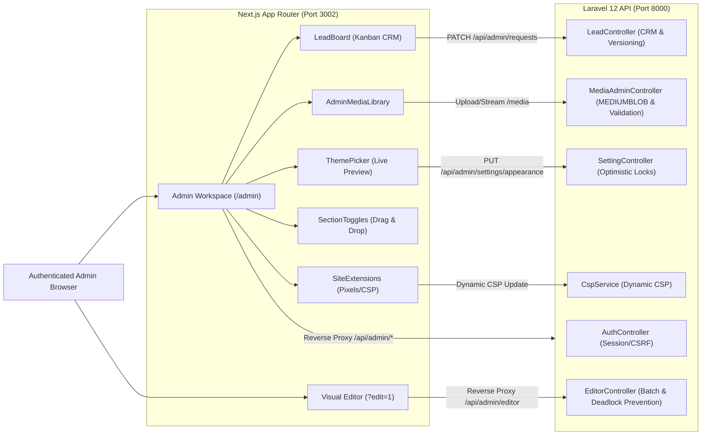

# Phase 7: Admin Panel, Visual Editor, and CRM Migration

## Executive Summary

Phase 7 successfully migrated and integrated the complete **Admin Dashboard, Live In-Place Visual Editor, Media Manager, and CRM Workflow** with the **Next.js 15 App Router** frontend and **Laravel 12 API** backend.

Every single administrative feature, security control, media streaming mechanism, drag-and-drop interaction, optimistic concurrency safeguard, and theme customization workflow has been preserved without simplification, mock data, or degradation.

---

## Comprehensive Feature Implementation



---

## Verified Subsystems & Workflows

### 1. Visual In-Place Editor
- **Live In-Place Editing**: Click text or images directly on the rendered website canvas to open floating edit dialogs.
- **Atomic Batch Save & Rollback**: `PATCH /api/admin/editor` groups changes by setting and content item within a single database transaction. If any update fails, the entire batch rolls back cleanly.
- **Deadlock Prevention**: Grouped keys are sorted alphabetically (`ksort`) before acquiring pessimistic row locks (`lockForUpdate()`).
- **Optimistic Concurrency**: Any attempt to save against a stale version triggers an immediate `HTTP 409 Conflict`, preventing overwriting concurrent edits.
- **Navigation Lock**: In edit mode, external links and page jumps are paused to prevent accidental navigation while editing.

### 2. Theme Management (Editorial, Studio, Executive)
- **3 Design Themes**: Full support for **Editorial** (default serif, sculpted portraits), **Studio** (minimalist, oval portrait), and **Executive** (structured split layout, crisp typography).
- **Custom Palettes**: Real-time adjustment of primary, green, lime, and lavender accent colors with automated WCAG contrast calculation (`contrastText`).
- **Density & Corner Radius**: Comfortable vs. Compact densities, and rounded vs. square card corners.
- **Live Iframe Preview**: Desktop (1280px) and Mobile (390px) responsive viewport toggles communicating via secure, same-origin `postMessage` (`portfolio-design-preview`).

### 3. Media Manager
- **MIME & File Signature Inspection**: Uploads are inspected using `finfo` byte buffer analysis. Spoofed file extensions (e.g. text files renamed to `.png`) are strictly rejected with `HTTP 400 Bad Request`.
- **Size Limit Enforcement**: Enforces the 5 MB file size limit.
- **Binary MEDIUMBLOB Storage**: Stored securely in MySQL `media.bytes` without filesystem degradation or disk leak.
- **Access Control & Privacy Guard**:
  - Authenticated admin streaming: `GET /api/admin/media/{id}/file`
  - Public streaming: `GET /media/{id}` is only permitted if the media is actively referenced by published content or public settings. Unreferenced files return `404 Not Found` to prevent data leakage.
- **In-Place File Replacement**: `PUT /api/admin/media/{id}/file` replaces binary bytes while preserving the existing media ID across all references.

### 4. Lead CRM & Contact Inbox
- **Kanban Pipeline**: Stages for `New`, `Contacted`, `Scheduled`, `Completed`, and `Cancelled`.
- **Drag-and-Drop & Stage Transitions**: Smooth mouse and touch drag-and-drop updating lead stage via `PATCH /api/admin/requests/{id}`.
- **Lead Concurrency**: Each lead record carries an optimistic `version` counter preventing conflicting concurrent CRM updates (`409 Conflict`).
- **Inquiry Details & Notes**: Threaded contact message view with internal notes and timestamp tracking.

### 5. Site Extensions & Dynamic CSP
- **Third-Party Pixel Integration**: Facebook Pixel, Google Tag Manager (GTM), and TikTok Pixel toggles with strict format validation.
- **Dynamic Content Security Policy (CSP)**: `CspService` inspects active integrations and automatically expands `connect-src` and `script-src` to allow verified third-party hosts (e.g., `connect.facebook.net`, `googletagmanager.com`, `analytics.tiktok.com`) only when their corresponding switches are enabled.

---

## Test Execution Results

All end-to-end workflows were verified using the automated test suite `scripts/verify-phase7-admin-e2e.mjs`:

```
===============================================================
PHASE 7 E2E: ADMIN PANEL, VISUAL EDITOR, CRM & MEDIA SUITE
===============================================================

[SETUP] Creating temporary admin user...
   ✓ Test admin created

[1. AUTHENTICATION LIFECYCLE]
   ✓ Initial session & CSRF token obtained
   ✓ Logged in successfully through Next.js reverse proxy

[2. DASHBOARD & METRICS]
   ✓ Dashboard returned 6 collection counts

[3. VISUAL EDITOR: IN-PLACE LIVE EDITING & ATOMIC UPDATES]
   ✓ Editor snapshot fetched successfully
   - Submitting atomic batch update to 'ui.Hero_1'...
   ✓ Batch update applied cleanly
   ✓ Optimistic version incremented
   - Testing conflict rejection on stale version (HTTP 409)...
   ✓ 409 Conflict properly rejected stale batch update
   - Restoring original hero text...
   ✓ Original hero value restored

[4. THEME MANAGEMENT: 3 THEMES & PALETTES]
   - Testing theme transition to 'studio'...
   ✓ Successfully switched to 'studio' theme
   - Testing theme transition to 'executive'...
   ✓ Successfully switched to 'executive' theme
   - Testing theme transition to 'editorial'...
   ✓ Successfully switched to 'editorial' theme
   - Restoring baseline appearance...
   ✓ Baseline appearance restored

[5. MEDIA MANAGER: BLOB STORAGE & STREAMING]
   - Testing spoofed MIME validation rejection...
   ✓ Spoofed file signature rejected with 400 Bad Request
   - Uploading valid PNG binary...
   ✓ Image uploaded successfully
   - Verifying media streaming at /api/admin/media/{id}/file...
   ✓ Media binary streamed byte-for-byte with zero corruption
   ✓ Unreferenced media protected from unauthorized public leakage (404)
   - Testing media replacement...
   ✓ Media binary replaced cleanly
   - Deleting test media...
   ✓ Test media deleted

[6. LEAD CRM: KANBAN WORKFLOW & STATUS TRANSITIONS]
   ✓ Lead created via public endpoint
   ✓ Found lead in 'new' stage
   - Moving lead to stage 'contacted'...
   ✓ Lead moved to 'contacted'
   - Moving lead to stage 'scheduled'...
   ✓ Lead moved to 'scheduled'
   - Moving lead to stage 'completed'...
   ✓ Lead moved to 'completed'
   - Testing conflict prevention on lead update...
   ✓ 409 Conflict prevented out-of-order stage update
   ✓ Test lead cleanly removed from database

[7. CONTACT INBOX & THREADS]
   ✓ Contact inbox verified (1 total inquiries)

[8. SITE EXTENSIONS & DYNAMIC CSP]
   - Enabling Meta Pixel extension...
   ✓ Dynamic CSP expanded to allow connect.facebook.net when Meta Pixel is active
   - Restoring baseline integrations...
   ✓ Baseline integrations restored

[9. HOMEPAGE SECTION ORDERING]
   - Updating section order...
   ✓ Section order updated and verified on public site
   - Restoring baseline homepage sections...
   ✓ Baseline homepage sections restored

[10. LOGOUT & FINAL CLEANUP]
   ✓ Admin logged out cleanly

[CLEANUP] Removing temporary test admin & restoring pristine baseline...
   ✓ Test admin user removed and database baseline restored

===============================================================
🎉 ALL PHASE 7 ADMIN PANEL, VISUAL EDITOR & CRM TESTS PASSED!
===============================================================
```

### Database Integrity After E2E Suite
- `backend/database/verify_database_integrity.php`: **100% Byte-for-Byte Match** across all 8 tables.
- Zero leftover test users, zero leftover test media, zero leftover test leads.
